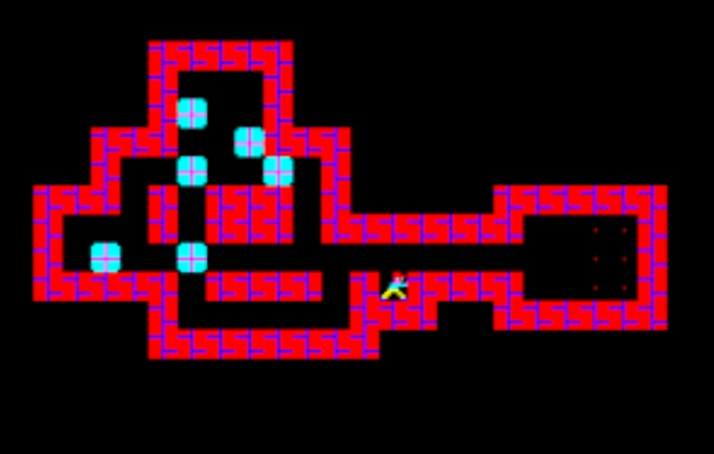
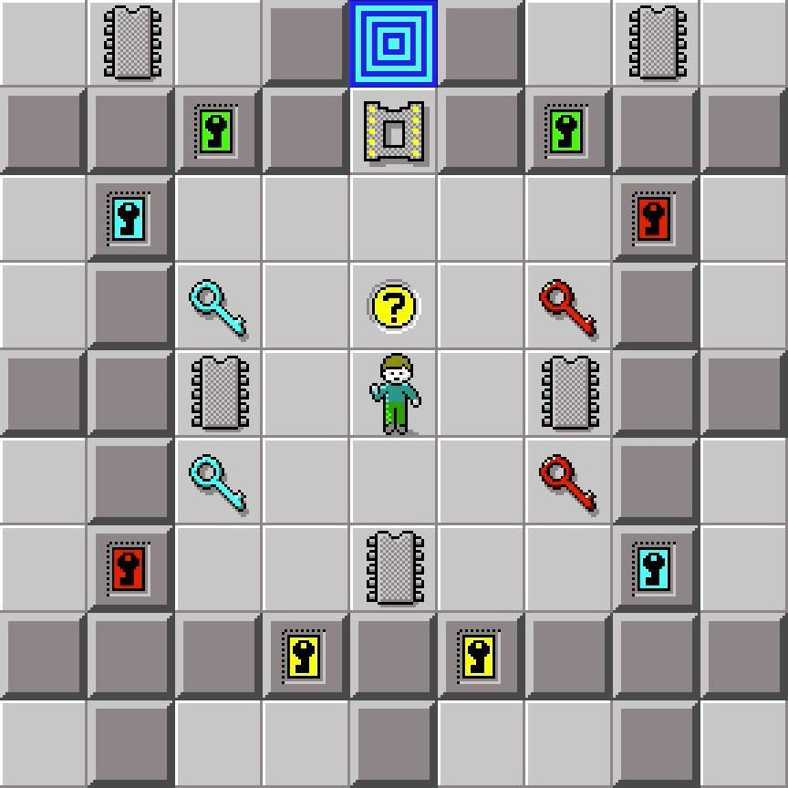

# Meta-Global-AI-Hackathon Jolly's Challenge

## Technical Uncertainty

Can an agent design fun and creative levels?

All the games I have been building up to this point run into the same issue, poor level design and game-pacing which relies on creative judgement.

I have to perform lots of manual playtesting and tweaking.

If I built a game small enough in-scope could I setup an experiment to see the boundaries of where an AI model can deliver good level design?

## Technical Limitations

- Keep the Meta Model API budget within $150
- Use assets only generated by Meta Muse Image 1.0 or newer
- Use Meta Muse Spark 1.3 or newer
- Use only Meta Muse Code

> Even though I have access to a subscription and Meta Wonder Full 1.0, I want to replicate the limitations that other Hackathon partipants are under.

If I run out of the $150 credits I'll a clear break from my code as branch.

## Game Environment

I orginally wanted to use Wolfstien 3D but the game is too complex, for the scope of a 10 day hackathon and I will go through my budget to quickly.

My original idea was making a clone of [Sokoban](https://en.wikipedia.org/wiki/Sokoban).

Its a simple game where you push boxes into specific locations.
That game is simple yet complex enough, but I didn't find the game itself fun, I found it focused on extereme logical challenges which for me was frustrating.

My wife enjoys the game [Chip's Challenge](https://en.wikipedia.org/wiki/Chip%27s_Challenge), and so that game is Sokoban-like, but with more mechanics and the "challenges" are not as logically frustrating.

I think we start with a simple Soko-ban clone and start adding featrures, and we don't focus on having extermely difficult logical challenges but just enough challenge with novel mechanics that makes you want to keep playing.

## Game-testing Research

To get a feel for these games:
- https://www.sokobanonline.com/
- https://archive.org/details/chips_challenge_windows_3.x