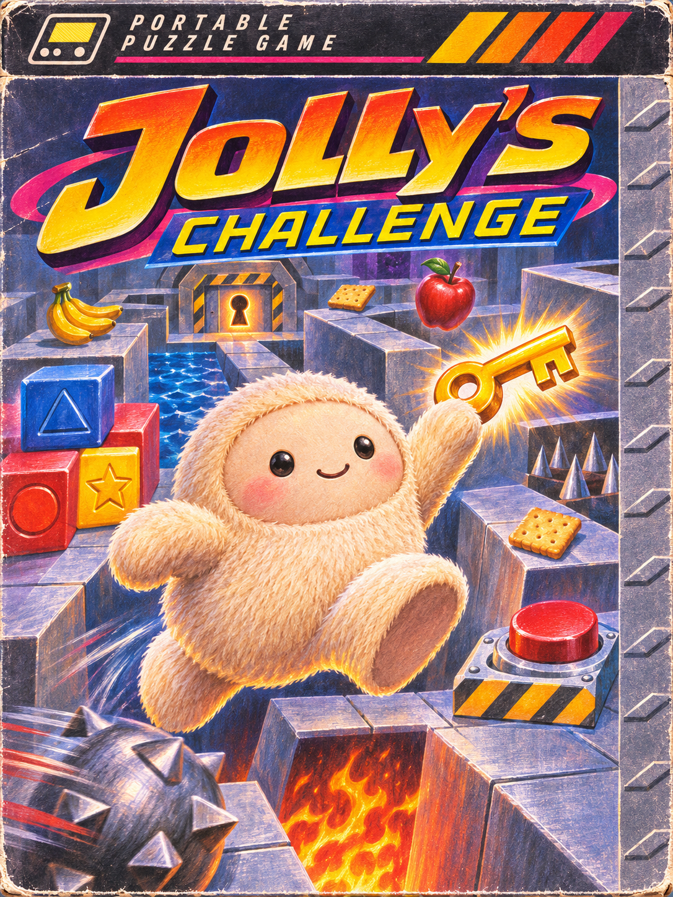

# Meta-Global-AI-Hackathon Jolly's Challenge

Jolly's Challenge is a game inspired by the 1989 Chips Challenge game.

- [Retrospective](./docs/retrospective.md)
- [Technical Uncertainty](./docs/technical-uncertainty.md)
- [Technical Limitations](./docs/technical-limitations.md)
- [Game Environment](./docs/game-env.md)
- [Game Testing Research](./docs/game-testing-research.md)
- [Game Lore and Mechanics](./docs/game-lore-and-mechanics.md)
- [Community Tools to Track Usage](./docs/community-tools-to-track-usage.md)
- [Mininal Graphical Assets](./docs/minimal-graphical-assets.md)
- [Project Manager and Simple Game Engine](./docs/pm-and-simple-game-engine.md)
- [Game Engine Refactor](./docs/game-engine-refactor.md)
- [Levle and Mechanics Planning](./docs/level-and-mechanics-planning.md)
- [Tools](./docs/tools.md)
