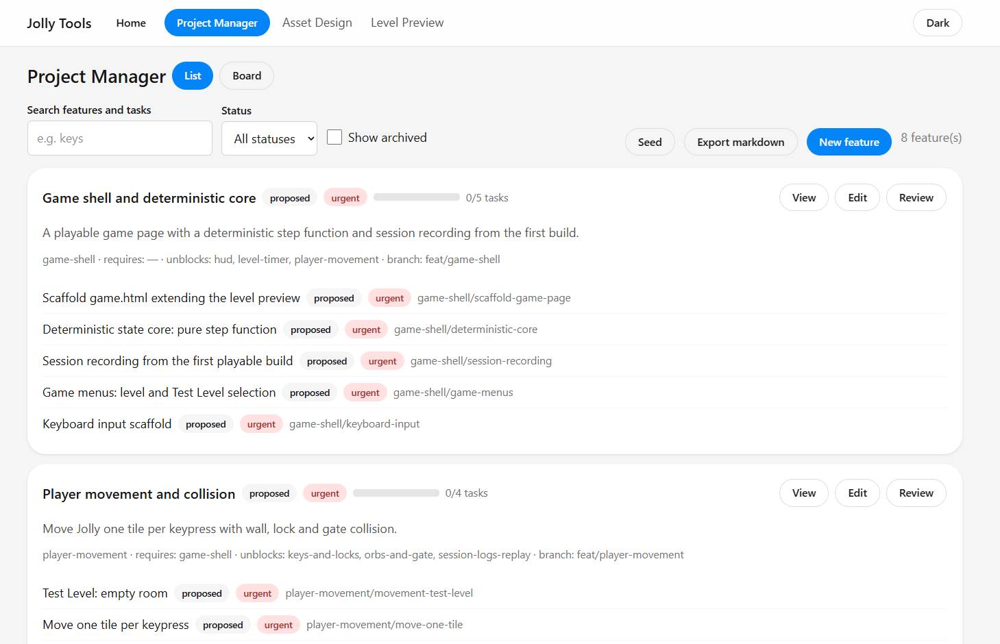
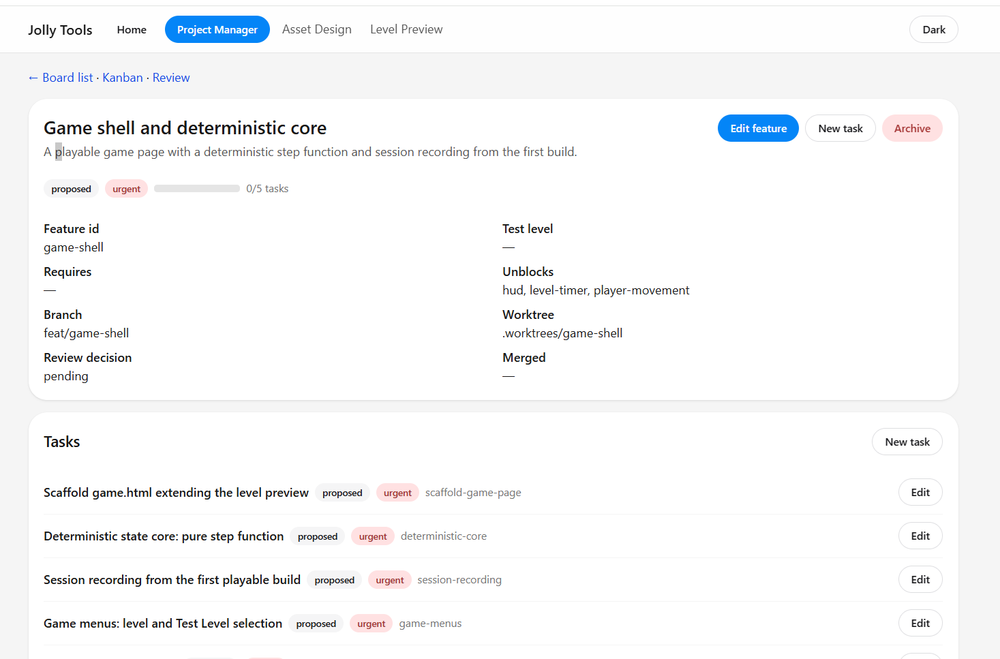
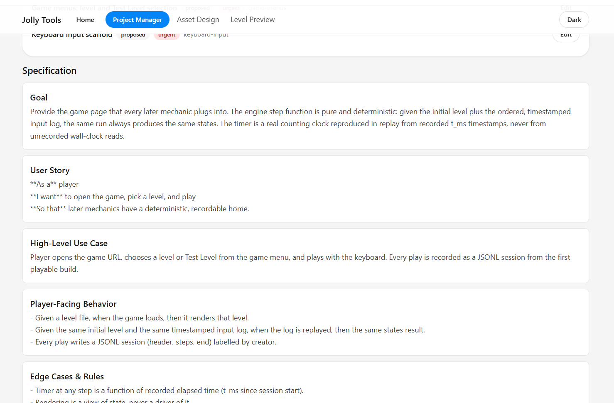

## Project Manager and Simple Game Engine

So we two things:
- a simple game engine that is determinstic, with session replay and logging
- a project manager so we can use feature driven development and test each feature as a human before merged into main.

We just rolled our own task manager/project manager using markdownfiles and SQLITE db.

I wanted to have features define in a specific template.
We will drive feature development from Muse Code interactive
We will let the agent handle the tasks, but we as the human stay focused on the high level features.

We made sure to have Test Levels so we can throughly test mechanics in isolate, and we expect the agent to add screenshots, save reply sessions, and allow to clearly inspect their work as well they have the tools to debug their issues.




The UI was becoming an issues so we looked for a component UI and added HeroUI

I rediscovered that muse-wonder-1.0 is avaible as an API and so I have started using wonder more generously. This would have save us so much trouble if I realized this sooner.

As using Spark was not efficent in many cases for UI development.

## Big Open Question

Should we allow feature development and task development to be driven by Spark or Wonder? We currently use Wonder medium - xhigh.


## UX Issues

When we got to implement the replay feature, Wonder was struggling with the UX.
I figured it time we try using https://www.skills.sh

I tried using HeroUI and the GUI for debugging called lava.
It just struggles to make a usable.

I ask ChatGPT to identify skills and give me prompt:

```sh
Use the interface-design and ux-usability-foundations skills to redesign the existing game replay/session debugging interface.This is an operator tool, not a marketing dashboard, settings panel, or Leva-style parameter editor.Primary workflows: select a recorded session, replay or pause it, scrub and step through events, inspect state at the selected step, annotate a step, and fork from that step.First analyze the existing screenshots and component structure. Propose the information architecture before making code changes.Requirements:- Preserve an unobstructed game viewport.
- Use one unified playback timeline and control bar.
- Keep a compact, readable step inspector beside the game.
- Make the current session, step, playback state, and available actions obvious.
- Hide infrequently used filtering and diagnostics until needed.
- Preserve existing replay functionality and keyboard usability.
- Inspect actual browser screenshots and critique the result before finishing.
```

Maybe should make finding skills and using them part of our workflow:

https://www.skills.sh/vercel-labs/skills/find-skills