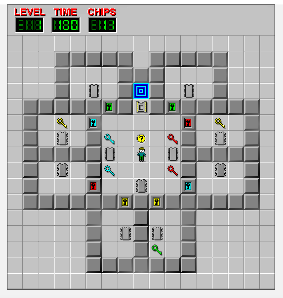

## Init Plan

### Build a Simple Game Engine For Our Clone

We are building a clone of the game Chip's Challenge.
We are going to add mechanics as we go but we will need
implement basic gameplay first.

We have a level-preview-tool, which uses pixijs.
So we can extend this into a new game engine tool.

Because our goal is to prodecural generate fun levels
using an LLM.

## Gameplay

- tilebase puzzle game, every asset of the game world fit it 1:1 ratio object.
  - excluding the UI
- each level has a timer
  - when the timer reaches zero you lose
- you can restart a level at any time by pressing R or click the restart button.
- wall - this is a wall block, collison player can't move
- key object
  - when player moves on to keys the pick the up, and it goes in their inventory
  - consumes key when pressing against locked wall block that has the same key colour and the block disolves
- when play moves ontop orbs they pick them up
  - it doesn't get added to inventory, it reduce the number of orbs counter
- player only has 8 inventory slots
- there is warp tile that takes to you to the next level.
  - warp tile is always blocked by a gate
- gate tile only opens after all orbs in level are collected
- player moves one tile a time using wasd or arrow keys

## Base Game Engine
Should be determinstic
Should have session logs of play I guess as jsonl files.
Should have the ability to replay a session
Should be able to take a point in a replay and start a new forked session

## UI
- countdown timer
- number of orbs left to collect
- current level

See full-level-ui as a reference image:

## Task Workflow

I want to break our features into tasks into markdown files using our
[template.md](./template.md)

I want to have a UI that looks like a list of tasks, but also kanban board mode.
I want to be be able to leave comments on a task.
I want Muse Code to know of the comment structure so as its working it can leave comments.

This tool I guess is project-manager-tool.